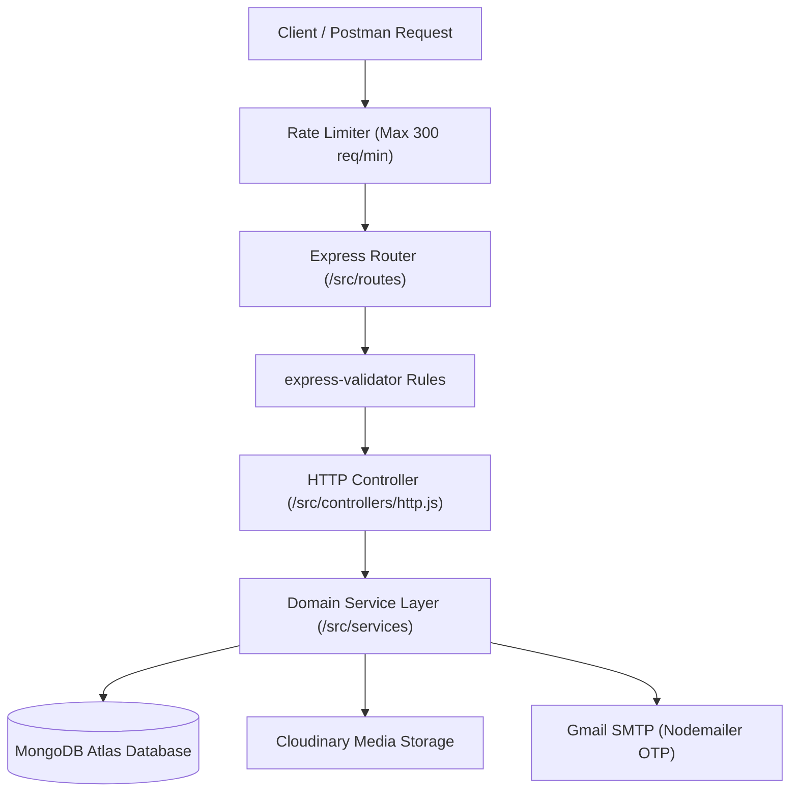
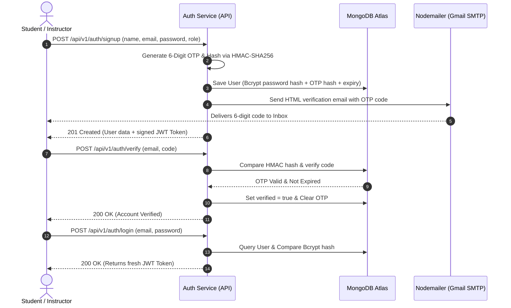
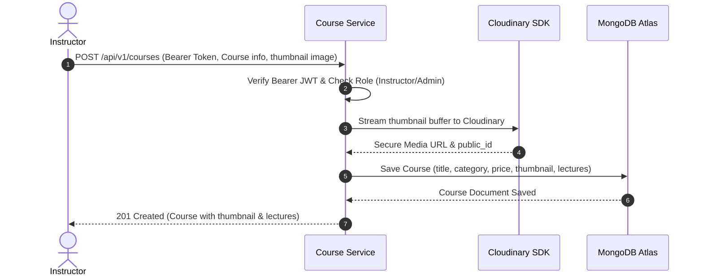
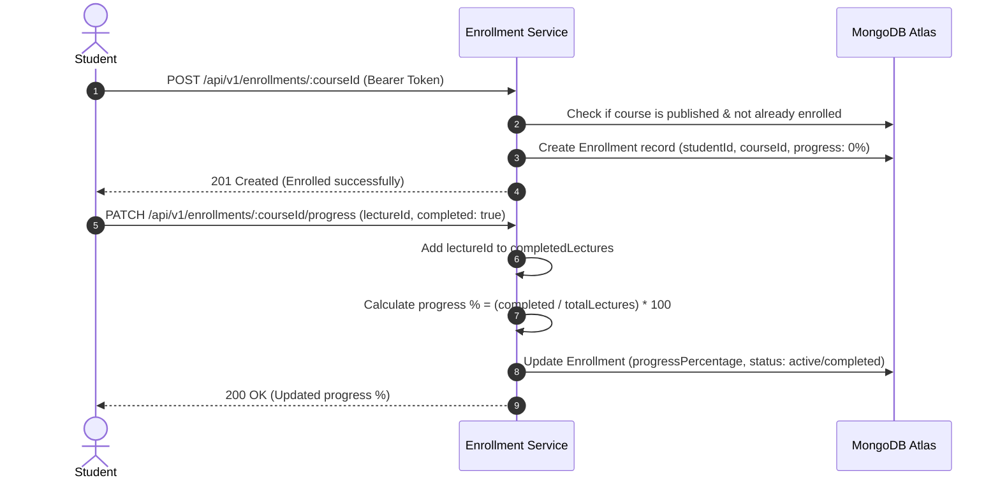
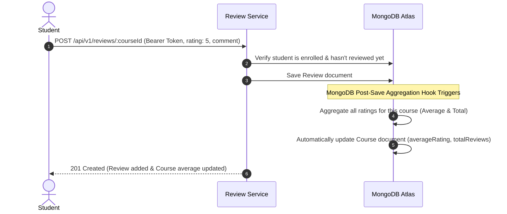

# EduLearn LMS - Enterprise Backend REST API

[](https://nodejs.org/)
[](https://expressjs.com/)
[](https://www.mongodb.com/atlas)
[](https://cloudinary.com/)
[](https://github.com/BasitHussain79/BE_BanoQabil)

A production-grade, modular Learning Management System (LMS) backend RESTful API built with **Node.js, Express (ES Modules), MongoDB Atlas, and Cloudinary**. 

Developed as part of the **Bano Qabil Backend Web Development Midterm Evaluation**, following the clean enterprise layered architecture demonstrated in [`BE_BanoQabil/be`](https://github.com/BasitHussain79/BE_BanoQabil/tree/project01/be).

---

## 📌 Midterm Project Submission Deliverables

1. **Project Overview Document:** [`PROJECT_OVERVIEW.md`](PROJECT_OVERVIEW.md) — Comprehensive technical specification, database ERD, route matrix, and presentation guide.
2. **Postman Collection:** [`EduLearn_LMS_Postman_Collection.json`](EduLearn_LMS_Postman_Collection.json) — Streamlined 9-request collection organized by module with automated JWT token handling.

---

## 🔄 System Architecture & Workflows

### 1. Overall System Architecture


---

### 2. Authentication & Email OTP Workflow


---

### 3. Course Creation & Cloudinary Media Workflow


---

### 4. Student Enrollment & Dynamic Progress Tracking


---

### 5. Course Reviews & Automated Rating Aggregation


---

## 📂 Project Architecture

The project strictly follows the enterprise service-oriented structure:

```text
mid term project/
├── .env                              # Private environment variables (gitignored)
├── .env.example                      # Template environment variables
├── .gitignore                        # Git ignore file
├── package.json                      # ES Modules ("type": "module") with native node --watch
├── server.js                         # Root forwarder to src/server.js
├── PROJECT_OVERVIEW.md               # Midterm Project Overview document
├── EduLearn_LMS_Postman_Collection.json # Streamlined Postman collection export
└── src/
    ├── app.js                        # App factory (createApp), rateLimit & routes mounting
    ├── server.js                     # Bootstrap, database connection & graceful shutdown
    ├── config/
    │   ├── adapter.js                # Nodemailer SMTP & Cloudinary stream adapters
    │   └── env.js                    # Environment validation (loadEnv)
    ├── controllers/
    │   └── http.js                   # respond helper translating HTTP to service calls
    ├── middleware/
    │   ├── auth.js                   # JWT protect and RBAC authorize middleware
    │   ├── error.js                  # Central error handling & in-memory rateLimit
    │   └── upload.js                 # Multer memory buffer upload
    ├── models/
    │   ├── user/index.js             # User model with Bcrypt & OTP hashes
    │   ├── course/index.js           # Course model with lectures & virtual reviews
    │   ├── enrollment/index.js       # Enrollment model with progress tracking
    │   └── review/index.js           # Review model with averageRating aggregate hook
    ├── routes/
    │   ├── auth/index.js             # /api/v1/auth (signup, verify, login, me)
    │   ├── course/index.js           # /api/v1/courses (CRUD, catalog, filter, publish)
    │   ├── enrollment/index.js       # /api/v1/enrollments (enroll, progress, dashboard)
    │   └── review/index.js           # /api/v1/reviews (add review, get course reviews)
    ├── services/
    │   ├── auth/index.js             # Auth business rules & JWT signing
    │   ├── course/index.js           # Course business logic & Cloudinary uploads
    │   ├── enrollment/index.js       # Enrollment & progress percentage math
    │   └── review/index.js           # Review validation & rating calculations
    ├── utils/
    │   ├── errors.js                 # AppError, assert helper, and publicUser mapper
    │   └── otp.js                    # makeOtp and hashOtp (HMAC-SHA256)
    └── validators/
        └── index.js                  # express-validator rule sets
```

---

## 🚀 Quickstart Guide

### 1. Installation
Clone the repository and install dependencies:
```bash
git clone https://github.com/Ayyan24/Midterm-Lms-Project-.git
cd Midterm-Lms-Project-
npm install
```

### 2. Environment Configuration
Create a `.env` file in the root directory (refer to `.env.example`):
```env
PORT=5000
NODE_ENV=development
MONGO_URI=mongodb+srv://<username>:<password>@cluster0.mongodb.net/edulearn_lms?retryWrites=true&w=majority
JWT_SECRET=your_jwt_secret_min_32_characters_long_key
OTP_SECRET=your_otp_secret_min_32_characters_long_key

# SMTP Configuration (Gmail)
SMTP_HOST=smtp.gmail.com
SMTP_PORT=587
SMTP_USER=your_email@gmail.com
SMTP_PASS=your_gmail_app_password
MAIL_FROM=your_email@gmail.com

# Cloudinary Configuration
CLOUDINARY_CLOUD_NAME=your_cloud_name
CLOUDINARY_API_KEY=your_api_key
CLOUDINARY_API_SECRET=your_api_secret
```

### 3. Run the Server
```bash
# Development mode with live file watching
npm run dev

# Or standard production mode
npm start
```
Server runs on: `http://localhost:5000`

---

## 📡 API Route Matrix

| Module | Method | Endpoint | Access | Description |
|---|---|---|---|---|
| **Auth** | `POST` | `/api/v1/auth/signup` | Public | Register user, hash password, and send OTP |
| **Auth** | `POST` | `/api/v1/auth/verify` | Public | Verify 6-digit OTP code |
| **Auth** | `POST` | `/api/v1/auth/login` | Public | Authenticate credentials and return signed JWT |
| **Auth** | `GET` | `/api/v1/auth/me` | Private | Retrieve authenticated user profile |
| **Courses** | `POST` | `/api/v1/courses` | Instructor, Admin | Create course with Cloudinary thumbnail & syllabus |
| **Courses** | `GET` | `/api/v1/courses` | Public | Browse catalog with search, filter, and pagination |
| **Enrollments** | `POST` | `/api/v1/enrollments/:courseId` | Student, User | Enroll in a published course |
| **Enrollments** | `GET` | `/api/v1/enrollments/my` | Student, User | Get student dashboard with lecture progress % |
| **Reviews** | `POST` | `/api/v1/reviews/:courseId` | Student, User | Submit 5-star rating (triggers rating rollup) |

---

## 🎯 4-Minute Presentation Walkthrough

Use the streamlined [`EduLearn_LMS_Postman_Collection.json`](EduLearn_LMS_Postman_Collection.json):

1. **Import in Postman:** Click **Import** ➔ select `EduLearn_LMS_Postman_Collection.json`.
2. **`1. Signup`:** Create a user ➔ inspect password hashing and OTP email delivery.
3. **`2. Verify OTP`:** Verify the 6-digit code received in email.
4. **`3. Login`:** Authenticate ➔ notice the token is **automatically stored** in `{{token}}`.
5. **`4. Get Profile (Me)`:** Demonstrate JWT Bearer token authentication.
6. **`5. Create Course`:** Instructor creates a course ➔ `courseId` is saved automatically.
7. **`6. Get All Courses`:** Demonstrate public catalog search and filters.
8. **`7. Enroll in Course`:** Enroll student into the newly created course.
9. **`8. My Enrolled Courses`:** Show student learning progress.
10. **`9. Add Course Review`:** Submit a review ➔ show automatic recalculation of course average rating.
